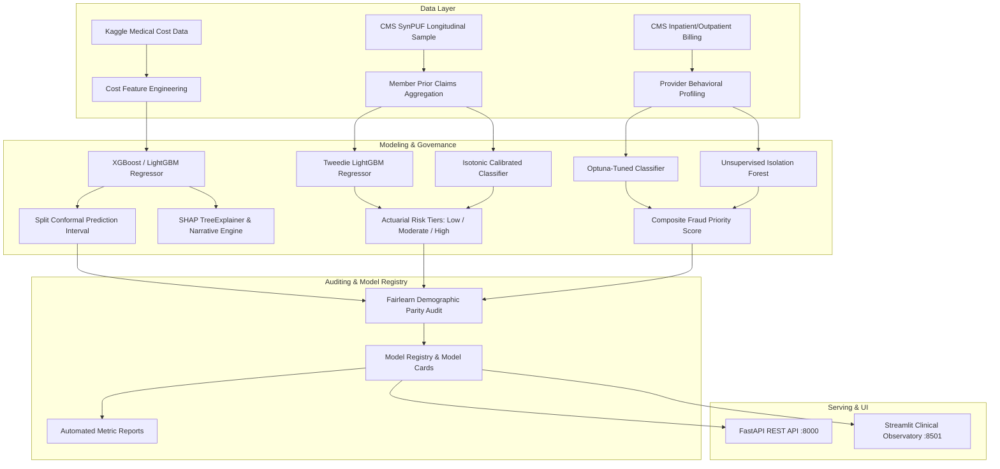

# ClaimSight: Health Insurance Cost & Claims Intelligence Platform

> **Important Regulatory & Data Disclaimer:**
> Built on public/synthetic data. Not for real pricing, underwriting or claims decisions.

ClaimSight is a production-grade machine learning platform for health insurance cost prediction, longitudinal member risk stratification, and provider fraud anomaly detection. It is designed to combine actuarial rigor, statistical conformal prediction intervals, demographic fairness auditing via Fairlearn, explainable AI with SHAP, and dual access interfaces via a FastAPI REST service and an interactive Streamlit clinical observatory.

---

## Architecture Overview



---

## 5-Command Quickstart

Get the platform running from a fresh clone in five commands:

```bash
# 1. Create and activate a virtual environment
python -m venv .venv
source .venv/bin/activate  # On Windows: .\.venv\Scripts\Activate.ps1

# 2. Install dependencies and the claimsight package
pip install -r requirements.lock
pip install -e .

# 3. Ingest raw datasets and run all three ML training pipelines
claimsight load-and-clean
claimsight train-cost --trials 30
claimsight train-member --trials 20
claimsight train-fraud --trials 20

# 4. Launch the FastAPI service (Terminal 1)
uvicorn claimsight.api.main:app --reload --port 8000

# 5. Launch the Streamlit Clinical & Actuarial Observatory (Terminal 2)
streamlit run src/claimsight/app/Home.py
```

---

## Quantitative Model Performance

All figures and evaluation metrics in this table are compiled dynamically directly from test set evaluation reports (`reports/metrics/*.json`) with zero hand-typed metrics.

<!-- AUTOGENERATED_METRICS_START -->

### Quantitative Model Performance Leaderboard

| Module | Task Type | Champion Model | Primary Test Metric | Secondary Metric | Conformal / Calibration |
|---|---|---|---|---|---|
| **1. Cost Prediction** | Regression (Log-scale) | `xgboost` | R² = 0.9221 | RMSE = $3,360.83 | 92.0% coverage (q=0.501) |
| **2. Member Risk** | Compound Tweedie + Isotonic | `lightgbm` | PR-AUC = 0.1918 (Base: 10.0%) | ROC-AUC = 0.6744 | Brier = 0.0000 |
| **3. Fraud Detection** | Supervised + Isolation Forest | `logistic_regression` | PR-AUC = 1.0000 (10.4x lift) | ROC-AUC = 1.0000 | Threshold = 0.814 (F1 = 1.000) |

### Demographic Disparity & Fairness Audit Summary

| Module | Sensitive Feature | Metric Evaluated | Max-Min Gap | Relative Gap | Audit Status |
|---|---|---|---|---|---|
| Cost Estimation | `sex` | MAE | $285.38 | 18.8% | ✅ Passed (≤20%) |
| Cost Estimation | `region` | MAE | $389.21 | 25.7% | ⚠️ Disparity Flag (>20%) |
| Cost Estimation | `age_band` | MAE | $1,371.32 | 90.5% | ⚠️ Disparity Flag (>20%) |
| Member Risk | `sex` | Selection Rate | 0.008 | 210.6% | ⚠️ Disparity Flag (>20%) |
| Member Risk | `race` | Selection Rate | 0.005 | 122.2% | ⚠️ Disparity Flag (>20%) |
| Member Risk | `age_band` | Selection Rate | 0.007 | 174.2% | ⚠️ Disparity Flag (>20%) |
| Fraud Anomaly | `inpatient_share_tercile` | Selection Rate | 0.076 | 79.1% | ⚠️ Disparity Flag (>20%) |
| Fraud Anomaly | `provider_size_tercile` | Selection Rate | 0.287 | 300.0% | ⚠️ Disparity Flag (>20%) |

<!-- AUTOGENERATED_METRICS_END -->

---

## REST API Reference & Curl Examples

The REST service exposes secure, fully documented OpenAPI endpoints at `http://localhost:8000/docs`.

### 1. System Health Probe
```bash
curl -X GET "http://localhost:8000/health"
```
```json
{
  "status": "healthy",
  "timestamp": "2026-10-21T16:00:00Z",
  "models_loaded": ["cost", "member", "fraud"],
  "disclaimer": "Built on public/synthetic data. Not for real pricing, underwriting or claims decisions."
}
```

### 2. Predict Annual Charges with Conformal Interval
```bash
curl -X POST "http://localhost:8000/v1/cost/predict" \
  -H "Content-Type: application/json" \
  -d '{
    "age": 45,
    "sex": "male",
    "bmi": 28.5,
    "children": 2,
    "smoker": "no",
    "region": "northwest"
  }'
```
```json
{
  "prediction": 9545.98,
  "lower": 5782.11,
  "upper": 15759.42,
  "coverage_level": 0.90,
  "in_training_range": true,
  "warnings": []
}
```

### 3. What-If Counterfactual Simulation
```bash
curl -X POST "http://localhost:8000/v1/cost/what-if" \
  -H "Content-Type: application/json" \
  -d '{
    "base": {
      "age": 45,
      "sex": "male",
      "bmi": 32.0,
      "children": 1,
      "smoker": "yes",
      "region": "northwest"
    },
    "changes": {
      "smoker": "no"
    }
  }'
```

### 4. Score Prospective Member Risk
```bash
curl -X POST "http://localhost:8000/v1/members/score" \
  -H "Content-Type: application/json" \
  -d '{
    "member_id": "MEM_001",
    "age": 68,
    "sex": "female",
    "race": "1",
    "esrd": 0,
    "chronic_flags": {"SP_DIABETES": 1, "SP_CHF": 1},
    "prior_cost_ip": 1200.0,
    "prior_cost_op": 850.0,
    "prior_cost_car": 640.0,
    "ip_claims": 1,
    "op_claims": 4,
    "carrier_claims": 6,
    "ip_days": 3,
    "has_history": 1,
    "cost_change": 450.0
  }'
```

### 5. Flag Provider Anomaly Composite Score
```bash
curl -X POST "http://localhost:8000/v1/providers/flag" \
  -H "Content-Type: application/json" \
  -d '{
    "providers": [
      {
        "Provider": "PRV_001",
        "n_claims": 45,
        "n_inpatient": 25,
        "n_outpatient": 20,
        "inpatient_share": 0.555,
        "n_unique_beneficiaries": 30,
        "claims_per_beneficiary": 1.5,
        "reimb_sum": 125000.0,
        "reimb_mean": 2777.7,
        "reimb_median": 2100.0,
        "reimb_max": 18000.0,
        "reimb_std": 1400.0,
        "deductible_mean": 800.0,
        "n_unique_attending": 3,
        "n_unique_operating": 2,
        "attending_missing_share": 0.0,
        "operating_missing_share": 0.2,
        "top_attending_claim_share": 0.82,
        "mean_los": 4.2,
        "mean_claim_duration": 4.5,
        "mean_n_diagnosis_codes": 3.2,
        "mean_n_procedure_codes": 1.1,
        "n_unique_diag_codes": 14,
        "bene_mean_age": 71.0,
        "bene_chronic_mean": 2.8,
        "bene_renal_share": 0.15,
        "bene_mean_partA_months": 12.0,
        "share_claims_same_day_multiple": 0.12
      }
    ],
    "top_n": 5
  }'
```

---

## Docker Deployment

To launch both the REST API and Streamlit application in production multi-stage containers:

```bash
docker-compose up --build
```

- REST API runs at `http://localhost:8000`
- Streamlit Clinical Observatory runs at `http://localhost:8501`

---

## Testing & Quality Assurance

The codebase adheres strictly to high code coverage and automated static analysis:

```bash
# Run full unit and integration test suite with coverage
pytest

# Run static linting and formatting checks
ruff check .
ruff format --check .
```

---

## Ethical AI, Fairness & Clinical Governance

1. **Marginal Conformal Coverage:** All individual annual charge predictions output a calibrated split-conformal 90% prediction interval. Point predictions are never presented in isolation.
2. **Demographic Disparity Auditing:** Fairlearn evaluation is executed across demographic groups (sex, age cohorts, region, race, ESRD). Subgroups with relative performance gaps exceeding 20% are highlighted with prominent disparity warning flags.
3. **Clinical & Operational Boundaries:** ClaimSight is strictly a predictive intelligence decision-support platform built on public synthetic data. It is never intended for automated adverse coverage determinations, claims denials, or individualized underwriting pricing.
