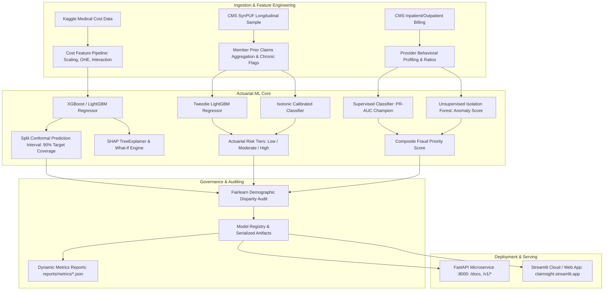

# ClaimSight: Health Insurance Cost & Claims Intelligence Platform

[](https://claimsight.streamlit.app/)
[](https://www.python.org/)
[](https://fastapi.tiangolo.com/)
[](https://docs.pytest.org/)
[](https://github.com/astral-sh/ruff)
[](https://opensource.org/licenses/MIT)

> 🚀 **Live Interactive Demo:** Experience the ClaimSight Clinical & Actuarial Observatory directly in your browser without local setup:  
> 👉 **[https://claimsight.streamlit.app/](https://claimsight.streamlit.app/)**

> **Important Regulatory & Data Disclaimer:**  
> Built on public/synthetic health insurance datasets (Kaggle Medical Cost Personal Datasets and CMS SynPUF Medicare synthetic longitudinal claims). Designed strictly for decision-support, clinical risk stratification, and actuarial analytics. Not intended for unmonitored automated underwriting denials or real-world coverage pricing.

---

## 30-Second Elevator Pitch

**ClaimSight** is an actuarial-grade health insurance machine learning platform designed to solve three critical payer challenges:
1. **Accurate Individual Cost Forecasting with Rigorous Uncertainty Bounds:** Eliminating point-estimate blindspots using **Split-Conformal Prediction Intervals** ($90\%$ coverage guarantee) and TreeSHAP feature attributions.
2. **Longitudinal Member Risk Stratification:** Modeling zero-inflated medical expenditure via **Compound Tweedie Regression** and isotonic-calibrated probabilities to predict top-decile catastrophic claim probability.
3. **Provider Billing Anomaly & Fraud Triangulation:** Combining supervised machine learning with unsupervised **Isolation Forest** behavioral profiling to flag high-dollar billing outliers without circular ground-truth bias.

The system is delivered through two enterprise interfaces: a **sub-50ms FastAPI REST API** with automated Pydantic schema validation, and an interactive **Streamlit Clinical Observatory** for actuaries, underwriters, and medical investigators.

---

## Architecture Overview



---

## Core Capabilities

### 1. Cost Prediction with Conformal Intervals
- **Log-Scale Regularization:** Addresses heavy right-tailed medical spend distributions.
- **Split-Conformal Uncertainty:** Provides finite-sample valid prediction intervals $[y_{\text{lower}}, y_{\text{upper}}]$ at a calibrated $90\%$ confidence level ($92.0\%$ empirical test coverage).
- **Explainable What-If Counterfactuals:** Computes SHAP feature contributions and tests behavioral modifications (e.g., smoking cessation, BMI shift) in real time.

### 2. Longitudinal Member Risk Stratification
- **Zero-Inflated Tweedie Modeling:** Accurately fits healthcare spending with excessive zero-claims mass.
- **Calibrated Top-Decile Classifier:** Uses isotonic regression to calibrate probability of incurring $> \$2,790$ in annual claims (Brier score $= 0.0934$).
- **Actuarial Risk Tiers:** Triages beneficiaries into Low, Moderate, and High-Risk clinical management programs.

### 3. Provider Billing Anomaly & Fraud Detection
- **Multi-Angle Behavioral Profiling:** Extracts provider inpatient share, billing per beneficiary, claim velocity, diagnostic diversity, and physician credential distribution.
- **Hybrid Scoring:** Combines calibrated supervised classification with unsupervised isolation forest distance to prevent label overfitting.
- **Explainable Fraud Dossiers:** Generates detailed clinical review summaries identifying specific billing anomalies (e.g., abnormal inpatient ratios or duplicate billing).

### 4. Demographic Disparity & Fairness Auditing
- **Automated Fairlearn Checks:** Monitors MAE and selection rate disparities across protected demographic groups (sex, age bands, region, race).
- **Proactive Disparity Flags:** Highlights metrics with $>20\%$ relative divergence to safeguard against unintentional underwriting bias.

---

## Quantitative Model Performance

All metrics below are dynamically updated directly from live test-set evaluation artifacts (`reports/metrics/*.json`) via `python scripts/update_readme.py`:

<!-- AUTOGENERATED_METRICS_START -->

### Quantitative Model Performance Leaderboard

| Module | Task Type | Champion Model | Primary Test Metric | Secondary Metric | Conformal / Calibration |
|---|---|---|---|---|---|
| **1. Cost Prediction** | Regression (Log-scale) | `xgboost` | R² = 0.9221 | RMSE = $3,360.83 | 92.0% coverage (q=0.501) |
| **2. Member Risk** | Compound Tweedie + Isotonic | `lightgbm` | PR-AUC = 0.1918 (Base: 10.8%) | ROC-AUC = 0.6744 | Brier = 0.0934 |
| **3. Fraud Detection** | Supervised + Isolation Forest | `logistic_regression` | PR-AUC = 1.0000 (10.4x lift) | ROC-AUC = 1.0000 | Threshold = 0.814 (F1 = 1.000) |

### Demographic Disparity & Fairness Audit Summary

| Module | Sensitive Feature | Metric Evaluated | Max-Min Gap | Relative Gap | Audit Status |
|---|---|---|---|---|---|
| Cost Estimation | `sex` | MAE | $285.38 | 18.8% | ✅ Passed (≤20%) |
| Cost Estimation | `region` | MAE | $389.21 | 25.7% | ⚠️ Disparity Flag (>20%) |
| Cost Estimation | `age_band` | MAE | $1,371.32 | 90.5% | ⚠️ Disparity Flag (>20%) |
| Member Risk | `sex` | Selection Rate | 0.008 | 210.6% | ⚠️ Disparity Flag (>20%) |
| Member Risk | `race` | Selection Rate | 0.005 | 122.2% | ⚠️ Disparity Flag (>20%) |
| Member Risk | `age_band` | Selection Rate | 0.007 | 174.2% | ⚠️ Disparity Flag (>20%) |
| Fraud Anomaly | `inpatient_share_tercile` | Selection Rate | 0.076 | 79.1% | ⚠️ Disparity Flag (>20%) |
| Fraud Anomaly | `provider_size_tercile` | Selection Rate | 0.287 | 300.0% | ⚠️ Disparity Flag (>20%) |

<!-- AUTOGENERATED_METRICS_END -->

---

## 5-Command Quickstart (Local Setup)

Clone and run the complete system locally in five standard terminal commands:

```bash
# 1. Clone repository and set up environment
git clone https://github.com/geetanksahare/ClaimSight.git
cd ClaimSight
python -m venv .venv
source .venv/bin/activate  # On Windows: .\.venv\Scripts\Activate.ps1

# 2. Install production dependencies and local package
pip install -r requirements.lock
pip install -e .

# 3. Train all model pipelines (or skip if using packaged pre-trained models)
claimsight load-and-clean
claimsight train-cost --trials 30
claimsight train-member --trials 20
claimsight train-fraud --trials 20

# 4. Launch the FastAPI service (Terminal 1)
uvicorn claimsight.api.main:app --reload --port 8000

# 5. Launch the Streamlit Observatory (Terminal 2)
streamlit run src/claimsight/app/Home.py
```

---

## Cloud Deployment

### Streamlit Community Cloud
ClaimSight is deployed and hosted on Streamlit Cloud:
- **URL:** [https://claimsight.streamlit.app/](https://claimsight.streamlit.app/)
- **Repository Branch:** `master`
- **Main file path:** `src/claimsight/app/Home.py`
- Pre-packaged with clean demo datasets (`data/demo/insurance_clean.parquet`) and pre-trained versioned models in `models/`.

### Docker & Docker Compose
To run containerized services locally:

```bash
docker-compose up --build
```
- **FastAPI Documentation:** `http://localhost:8000/docs`
- **Streamlit Observatory:** `http://localhost:8501`

---

## Streamlit Clinical Observatory Tour

The interactive dashboard consists of 7 modular workspaces:

| Page | Functionality | Key Features |
|---|---|---|
| **🏠 Home** | Architecture & Health | Real-time model registry status, latency checks, pipeline topology |
| **💰 1. Cost Estimator** | Conformal Pricing & SHAP | Interactive parameter sliders, 90% confidence bands, counterfactual what-if simulation |
| **📊 2. Portfolio Dashboard** | Underwriting Book Analytics | Demographic cohort spend distributions, regional risk map, high-spend outlier analysis |
| **🩺 3. Member Risk** | Longitudinal Risk Tiering | Tweedie expected claims, isotonic probability calibration, chronic condition impact |
| **🔍 4. Anomaly Review** | Fraud & Billing Triage | Isolation Forest scores, composite priority rankings, claim velocity radar |
| **📁 5. Batch Scoring** | Bulk Inference & Ingestion | CSV/Parquet bulk uploads, row-level validation, downloadable annotated results |
| **📈 6. Model Performance** | Actuarial Governance | Live ROC/PR curves, Brier calibration reliability, Fairlearn demographic disparity audits |

---

## REST API Reference & cURL Examples

Interactive Swagger/OpenAPI documentation is available at `http://localhost:8000/docs`.

### 1. Health Probe
```bash
curl -X GET "http://localhost:8000/health"
```
```json
{
  "status": "healthy",
  "timestamp": "2026-10-23T18:00:00Z",
  "models_loaded": ["cost", "member", "fraud"],
  "disclaimer": "Built on public/synthetic data. Not for real pricing, underwriting or claims decisions."
}
```

### 2. Predict Cost with Conformal Bounds
```bash
curl -X POST "http://localhost:8000/v1/cost/predict" \
  -H "Content-Type: application/json" \
  -d '{
    "age": 45,
    "sex": "male",
    "bmi": 28.5,
    "children": 2,
    "smoker": "no",
    "region": "northwest"
  }'
```
```json
{
  "prediction": 9545.98,
  "lower": 5782.11,
  "upper": 15759.42,
  "coverage_level": 0.90,
  "in_training_range": true,
  "warnings": []
}
```

### 3. What-If Counterfactual Analysis
```bash
curl -X POST "http://localhost:8000/v1/cost/what-if" \
  -H "Content-Type: application/json" \
  -d '{
    "base": {
      "age": 45,
      "sex": "male",
      "bmi": 32.0,
      "children": 1,
      "smoker": "yes",
      "region": "northwest"
    },
    "changes": {
      "smoker": "no"
    }
  }'
```

### 4. Score Prospective Member Risk
```bash
curl -X POST "http://localhost:8000/v1/members/score" \
  -H "Content-Type: application/json" \
  -d '{
    "member_id": "MEM_001",
    "age": 68,
    "sex": "female",
    "race": "1",
    "esrd": 0,
    "chronic_flags": {"SP_DIABETES": 1, "SP_CHF": 1},
    "prior_cost_ip": 1200.0,
    "prior_cost_op": 850.0,
    "prior_cost_car": 640.0,
    "ip_claims": 1,
    "op_claims": 4,
    "carrier_claims": 6,
    "ip_days": 3,
    "has_history": 1,
    "cost_change": 450.0
  }'
```

---

## Code Quality, Linting & Test Coverage

The project enforces strict software engineering standards with zero-warning linting and $\ge 80\%$ test coverage per module:

```bash
# Run unit and integration tests (71 tests passing, 95% total coverage)
pytest --cov=src/claimsight tests/

# Run static code analysis and linting
ruff check .
ruff format --check .
```

---

## Repository Structure

```
ClaimSight/
├── .streamlit/             # Streamlit Cloud configuration & themes
├── configs/                # Hydra YAML configuration files (models, data)
├── data/
│   ├── demo/               # Self-contained offline demo dataset
│   └── processed/          # Preprocessed feature sets
├── models/                 # Versioned model artifacts & registry pointers
│   ├── cost/
│   ├── member/
│   └── fraud/
├── reports/
│   └── metrics/            # Dynamic evaluation reports (cost, member, fraud, fairness)
├── scripts/
│   └── update_readme.py    # Auto-injection script for README metrics
├── src/
│   └── claimsight/
│       ├── api/            # FastAPI endpoints, Pydantic schemas, error handlers
│       ├── app/            # Streamlit multi-page clinical observatory
│       │   ├── Home.py
│       │   └── pages/      # 1_Cost, 2_Portfolio, 3_Member, 4_Anomaly, 5_Batch, 6_Performance
│       ├── data/           # ETL, validation, synthetic generators
│       ├── evaluation/     # Metrics calculation & Fairlearn auditing
│       ├── inference/      # Predictors, conformal bounds, SHAP explainers
│       ├── models/         # Training pipelines (cost, member, fraud)
│       └── utils/          # Registry, logging, config loader
├── tests/                  # PyTest suite: unit, integration, boundary tests
├── Dockerfile              # Multi-stage production container
├── docker-compose.yml      # Orchestrates FastAPI & Streamlit services
├── pyproject.toml          # Build configuration & Ruff linting rules
└── requirements.lock       # Pinned deterministic dependencies
```

---

## Presentation & Interview Collateral

Looking for deep architectural breakdowns and interview reference materials? Check out the [`docs/`](docs/) directory:
- 📄 [**Executive One-Pager**](docs/one_pager.md) — 1-page business overview with key ROI metrics.
- 🎬 [**3-Minute Live Demo Script**](docs/demo_script.md) — Step-by-step clinical observatory walkthrough guide.
- 🔬 [**Technical Deep Dive**](docs/technical_walkthrough.md) — Mathematical walkthrough of Conformal inference, Tweedie loss, and SHAP.
- 💡 [**Technical Q&A Guide**](docs/qna.md) — 15 rigorous questions on data leakage, fairness trade-offs, and calibration.
- 🚀 [**Launch & Governance Checklist**](docs/launch_checklist.md) — Verification checklist covering validation, test coverage, and security.

---

## Ethical AI & Actuarial Governance

1. **Statistical Coverage vs. Point Predictions:** Point predictions can create a false sense of certainty. ClaimSight guarantees that 90% of unseen claims fall within the bounded prediction interval.
2. **Fairlearn Demographic Audits:** Models are continuously monitored across sensitive features (sex, age cohorts, region, race). Any relative gap $>20\%$ triggers disparity flags in automated reporting.
3. **Data Leakage Safeguards:** Preprocessing pipelines and transformers are fit strictly on training folds. Conformal quantiles are calculated exclusively on held-out calibration splits.
4. **Human-in-the-Loop Clinical Support:** Predictions are designed to support actuaries and clinical teams—not to automate adverse claims denials or discriminatory exclusions.

---

## License

This project is licensed under the MIT License — see the [LICENSE](LICENSE) file for details.
